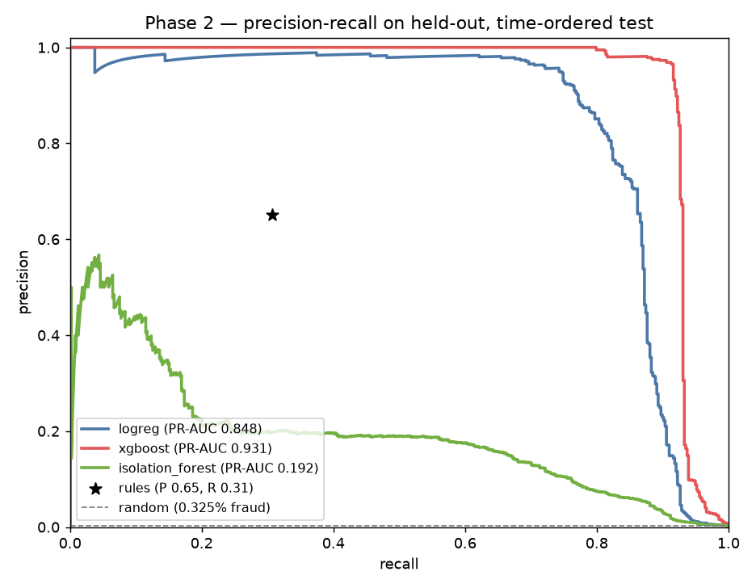
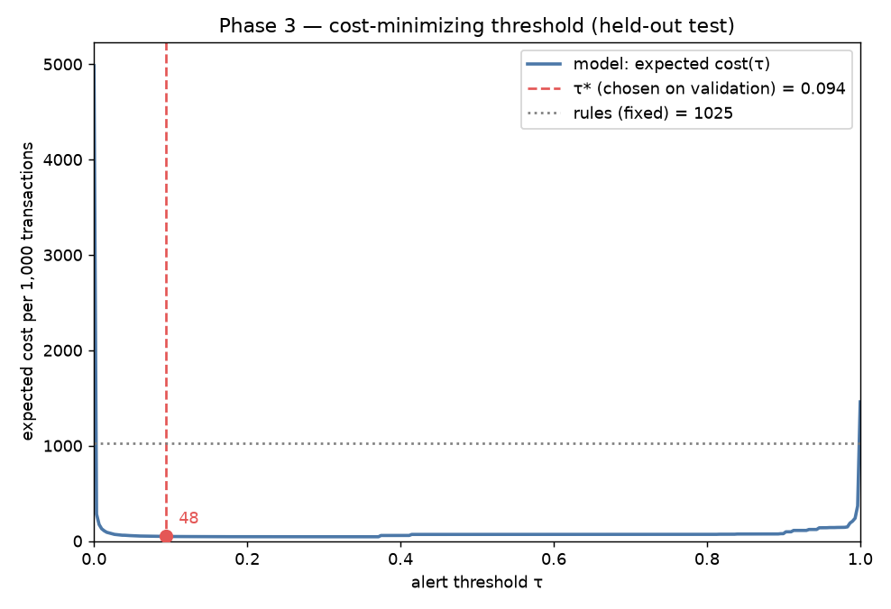

# Fraud Monitor

Un détecteur de fraude en temps réel que l'on attaque avec son propre bot
fraudeur adaptatif, puis que l'on durcit par ré-entraînement. Les règles
constituent la baseline ; le cœur du travail, c'est le ML, le seuil d'alerte
optimisé par les coûts, et la course à l'armement attaquant/défenseur.

**Résultats visés :** le seuil d'alerte qui minimise le coût attendu (avec
intervalle de confiance), et la preuve que le ré-entraînement bat un attaquant
adaptatif.

---

## État d'avancement

| Phase | Contenu | État |
|------|---------|------|
| 1 | Données + baseline de règles | ✅ terminé |
| 2 | Détecteur ML (LogReg, XGBoost, Isolation Forest) | ✅ terminé |
| 3 | Couche quant (seuil minimisant le coût, IC bootstrap, SHAP) | ✅ terminé |
| 4 | Course à l'armement adverse (attaquant vs. ré-entraînement) | ⬜ à suivre |
| 5 | Mise en production (flux, dashboard, write-up) | ⬜ |

**Résultat phare (Phase 3) :** le seuil minimisant le coût **économise ~979 par
1 000 transactions** vs les règles sur le jeu de test tenu à l'écart, IC 95 %
bootstrap **[686, 1289]**.

## Résultat Phase 1 — la baseline que tout modèle devra battre

Données synthétiques : ~589k transactions, **0,28 % de fraude** (comparable au
0,172 % du jeu Kaggle), découpées **par le temps** (jamais aléatoirement) en
75 % entraînement / 25 % test.

Moteur de règles sur le jeu de test tenu à l'écart et ordonné dans le temps :

| règle | précision | rappel |
|-------|-----------|--------|
| vélocité | 1,00 | 0,26 |
| voyage impossible | 0,79 | 0,03 |
| pic de montant | 0,12 | 0,02 |
| **alerte combinée** | **0,65** | **0,31** |


**Lecture :** les règles attrapent ~un tiers des fraudes avec 65 % de précision.
Elles sont fortes sur les rafales de vélocité et précises sur le voyage
impossible, mais **ratent presque entièrement le card-testing (9 % de rappel)**
— les petites transactions de test en ligne ressemblent à du trafic normal pour
une règle. C'est précisément ce trou que le détecteur ML devra combler en Phase 2.

## Résultat Phase 2 — le détecteur ML bat nettement les règles

Mêmes données, même découpage temporel. On construit des **features causales**
(comptes/montants glissants par carte sur 1 min / 1 h / 24 h, temps depuis la
dernière transaction, distance et vitesse implicite, ratio à la médiane passée
de l'utilisateur, risque marchand), puis on entraîne trois détecteurs et on les
compare en **PR-AUC** (aire sous la courbe précision-rappel) sur le même jeu de
test tenu à l'écart.

| modèle | PR-AUC | rappel @ précision ≥ 0,90 |
|--------|--------|---------------------------|
| règles (baseline) | 0,202 | 0 % |
| régression logistique (plancher) | 0,848 | 77 % |
| **XGBoost** | **0,931** | **92 %** |
| Isolation Forest | 0,192 | 0 % |



**Lecture :**
- **XGBoost fait 4,6× la PR-AUC des règles** et attrape **92 % des fraudes à
  90 % de précision** — un point de fonctionnement que les règles n'atteignent
  jamais.
- La régression logistique (le plancher « de contrôle ») écrase déjà les règles ;
  XGBoost la dépasse encore.
- L'**Isolation Forest est faible ici** (PR-AUC 0,192, sous les règles) : la
  fraude de ce jeu n'est pas un simple « point aberrant » dans l'espace des
  features, le signal supervisé est bien plus fort. On le garde quand même — sa
  vraie valeur se mesurera en Phase 4 face à des **types d'attaque inédits**.
- **Validation croisée temporelle** (XGBoost, 5 plis) : PR-AUC moyenne **0,908
  (± 0,022)** — stable d'un pli à l'autre, le résultat n'est pas un coup de chance.
- **Calibration** : Brier 0,0015 (vs 0,0032 pour « prédire le taux de base ») —
  les probabilités de XGBoost sont exploitables telles quelles pour la Phase 3.

## Résultat Phase 3 — du classifieur au système de décision

Le meilleur seuil n'est **pas** celui qui maximise le F1, mais celui qui
**minimise le coût attendu** :

$$C(\tau) = \sum_i \big[ \mathbb{1}(p_i < \tau)\, y_i\, a_i \;+\; \mathbb{1}(p_i \ge \tau)\,(1 - y_i)\, c_{review} \big]$$

Une fraude ratée coûte le montant `a_i` ; une fausse alerte coûte `c_review`
(frais de revue + friction = 5). Le seuil τ* est choisi sur un jeu de
**validation** (jamais sur le test), puis évalué sur le test.

| politique | coût / 1 000 transactions |
|-----------|---------------------------|
| tout autoriser | 1459 |
| règles | 1025 |
| modèle naïf @ τ=0,24 | 100 |
| **modèle sensible-au-coût @ τ=0,09** | **48** |



**→ Le seuil minimisant le coût économise ~979 par 1 000 transactions vs les
règles, IC 95 % bootstrap [686, 1289].**

**Le résultat le plus instructif du projet :** le modèle naïf (excellent en
PR-AUC) ne battait d'abord **pas** les règles sur le *coût*, car le coût est
pondéré par le montant et dominé par de rares fraudes à gros montant — et le
seuil seul ne répare pas un modèle entraîné sur le mauvais objectif. La solution
quant : un **entraînement sensible au coût** (chaque fraude pondérée par son
montant), qui divise par deux le coût du modèle naïf (48 vs 100).

Autres livrables de la phase :
- **SHAP par alerte** (TreeSHAP natif de XGBoost) : chaque alerte affiche ses
  3 raisons principales (p. ex. un pic de montant → `log_amount`,
  `amount_ratio_user_median`).
- **Seuil global vs par tranche de montant** : un seuil par tranche n'améliore le
  coût que de ~1 % — **marginal, pas la peine** d'ajouter la complexité.

## Décisions de conception

- **Les données synthétiques sont la colonne vertébrale**, Kaggle est un benchmark
  séparé de la Phase 2. Les features de Kaggle sont anonymisées par PCA
  (`V1..V28`), elles ne peuvent donc pas supporter la vélocité par carte, le
  voyage impossible géographique, ni un attaquant qui manipule de vrais leviers.
  Notre générateur expose exactement ces leviers (`src/schema.py` est le contrat
  partagé).
- **Aucune fuite de données, garantie par un test.** Toutes les règles (et plus
  tard, toutes les features) n'utilisent que les transactions d'instant `< t`.
  `test_rules_are_causal` prouve qu'une décision ne change pas quand on masque le
  futur.
- **Pas de métrique d'accuracy.** À 0,28 % de fraude, « 99,7 % correct » ne veut
  rien dire. On rapporte précision / rappel / F1 (et la PR-AUC dès la Phase 2).
- **Volume de fraude suffisant pour la puissance statistique.** Le taux reste
  réaliste (~0,28 %) mais on injecte assez de chaque pattern — surtout les rares
  à gros montant — pour que le signal soit apprenable et que l'estimation de coût
  ne dépende pas de 2-3 fraudes chanceuses.

## Arborescence

```
src/
  schema.py            # le contrat partagé (colonnes, catégories, patterns de fraude)
  generator.py         # transactions synthétiques + 4 patterns de fraude injectables
  rules.py             # vélocité / voyage-impossible / pic-de-montant (toutes causales)
  split.py             # découpage train/test ordonné dans le temps
  metrics.py           # précision/rappel/F1, confusion, rappel par pattern
  run_baseline.py      # point d'entrée Phase 1 -> chiffres de la baseline
  make_chart.py        # génère reports/phase1_rule_baseline.png
  # --- Phase 2 ---
  features.py          # features causales + risque marchand (fit sur train seul)
  ml_metrics.py        # PR-AUC, rappel@précision (jamais ROC-AUC / accuracy)
  models.py            # LogReg (plancher), XGBoost, Isolation Forest
  run_phase2.py        # point d'entrée Phase 2 -> tableau comparatif + CV + calibration
  make_chart_phase2.py # génère reports/phase2_model_comparison.png
  # --- Phase 3 ---
  costs.py             # modèle de coût C(τ), balayage, seuil optimal, bootstrap, par-tranche
  explain.py           # raisons SHAP top-3 par alerte (TreeSHAP natif XGBoost)
  run_phase3.py        # point d'entrée Phase 3 -> seuil optimal + IC + SHAP
  make_chart_phase3.py # génère reports/phase3_cost_curve.png
  test_baseline.py     # schéma, ordre temporel, garantie anti-fuite (règles)
  test_features.py     # garantie anti-fuite (features)
notebooks/
data/                  # artefacts générés (ignoré par git)
reports/               # graphiques de résultats (un par phase)
```

## Lancer le projet

```bash
python -m venv .venv && source .venv/bin/activate
pip install -r requirements.txt
python src/run_baseline.py     # affiche la baseline Phase 1 (règles)
python src/run_phase2.py       # entraîne les 3 modèles + tableau comparatif
python src/run_phase3.py       # seuil optimisant le coût + IC bootstrap + SHAP
python src/test_baseline.py    # tests Phase 1 (dont la garantie anti-fuite)
python src/test_features.py    # test anti-fuite des features Phase 2
python src/make_chart.py src/make_chart_phase2.py src/make_chart_phase3.py # graphiques
# ou : make run   /   make phase2   /   make phase3
```
