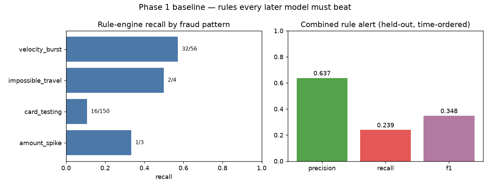

# Fraud Monitor

Un détecteur de fraude en temps réel que l'on attaque avec son propre bot
fraudeur adaptatif, puis que l'on durcit par ré-entraînement. Les règles
constituent la baseline ; le cœur du travail, c'est le ML, le seuil d'alerte
optimisé par les coûts, et la course à l'armement attaquant/défenseur.

**Résultats visés :** le seuil d'alerte qui minimise le coût attendu (avec
intervalle de confiance), et la preuve que le ré-entraînement bat un attaquant
adaptatif.

---

## État d'avancement

| Phase | Contenu | État |
|------|---------|------|
| 1 | Données + baseline de règles | ✅ terminé |
| 2 | Détecteur ML (LogReg, XGBoost, Isolation Forest) | ✅ terminé |
| 3 | Couche quant (seuil minimisant le coût, IC bootstrap, SHAP) | ⬜ à suivre |
| 4 | Course à l'armement adverse (attaquant vs. ré-entraînement) | ⬜ |
| 5 | Mise en production (flux, dashboard, write-up) | ⬜ |

## Résultat Phase 1 — la baseline que tout modèle devra battre

Données synthétiques : ~262k transactions, **0,18 % de fraude** (comparable au
0,172 % du jeu Kaggle), découpées **par le temps** (jamais aléatoirement) en
75 % entraînement / 25 % test.

Moteur de règles sur le jeu de test tenu à l'écart et ordonné dans le temps :

| règle | précision | rappel |
|-------|-----------|--------|
| vélocité | 1,00 | 0,23 |
| voyage impossible | 1,00 | 0,01 |
| pic de montant | 0,03 | 0,01 |
| **alerte combinée** | **0,64** | **0,24** |



**Lecture :** les règles attrapent ~un quart des fraudes avec 64 % de précision.
Elles sont fortes sur les rafales de vélocité et précises sur le voyage
impossible, mais **ratent presque entièrement le card-testing (11 % de rappel)**
— les petites transactions de test en ligne ressemblent à du trafic normal pour
une règle. C'est précisément ce trou que le détecteur ML devra combler en Phase 2.

> Mise en garde sur les petits échantillons : `voyage impossible` (2/4) et
> `pic de montant` (1/3) ont peu de positifs dans la fenêtre de test car chaque
> épisode ne fait qu'1–2 lignes. Augmenter leur part dans `GenConfig.pattern_mix`
> pour des chiffres par pattern plus stables.

## Résultat Phase 2 — le détecteur ML bat nettement les règles

Mêmes données, même découpage temporel. On construit des **features causales**
(comptes/montants glissants par carte sur 1 min / 1 h / 24 h, temps depuis la
dernière transaction, distance et vitesse implicite, ratio à la médiane passée
de l'utilisateur, risque marchand), puis on entraîne trois détecteurs et on les
compare en **PR-AUC** (aire sous la courbe précision-rappel) sur le même jeu de
test tenu à l'écart.

| modèle | PR-AUC | rappel @ précision ≥ 0,90 |
|--------|--------|---------------------------|
| règles (baseline) | 0,155 | 0 % |
| régression logistique (plancher) | 0,781 | 70 % |
| **XGBoost** | **0,900** | **84,5 %** |
| Isolation Forest | 0,121 | 0 % |


**Lecture :**
- **XGBoost fait 5,8× la PR-AUC des règles** et attrape **84,5 % des fraudes à
  90 % de précision** — un point de fonctionnement que les règles n'atteignent
  jamais.
- La régression logistique (le plancher « de contrôle ») écrase déjà les règles ;
  XGBoost la dépasse encore.
- L'**Isolation Forest est faible ici** (PR-AUC 0,121, sous les règles) : la
  fraude de ce jeu n'est pas un simple « point aberrant » dans l'espace des
  features, le signal supervisé est bien plus fort. On le garde quand même — sa
  vraie valeur se mesurera en Phase 4 face à des **types d'attaque inédits**.
- **Validation croisée temporelle** (XGBoost, 5 plis) : PR-AUC moyenne 0,75
  (± 0,18) — les premiers plis ont peu de fraudes donc la variance est réelle, à
  dire honnêtement.
- **Calibration** : Brier 0,0008 (vs 0,0032 pour « prédire le taux de base ») —
  les probabilités de XGBoost sont exploitables telles quelles pour la Phase 3.

## Décisions de conception

- **Les données synthétiques sont la colonne vertébrale**, Kaggle est un benchmark
  séparé de la Phase 2. Les features de Kaggle sont anonymisées par PCA
  (`V1..V28`), elles ne peuvent donc pas supporter la vélocité par carte, le
  voyage impossible géographique, ni un attaquant qui manipule de vrais leviers.
  Notre générateur expose exactement ces leviers (`src/schema.py` est le contrat
  partagé).
- **Aucune fuite de données, garantie par un test.** Toutes les règles (et plus
  tard, toutes les features) n'utilisent que les transactions d'instant `< t`.
  `test_rules_are_causal` prouve qu'une décision ne change pas quand on masque le
  futur.
- **Pas de métrique d'accuracy.** À 0,18 % de fraude, « 99,8 % correct » ne veut
  rien dire. On rapporte précision / rappel / F1 (et la PR-AUC dès la Phase 2).

## Arborescence

```
src/
  schema.py            # le contrat partagé (colonnes, catégories, patterns de fraude)
  generator.py         # transactions synthétiques + 4 patterns de fraude injectables
  rules.py             # vélocité / voyage-impossible / pic-de-montant (toutes causales)
  split.py             # découpage train/test ordonné dans le temps
  metrics.py           # précision/rappel/F1, confusion, rappel par pattern
  run_baseline.py      # point d'entrée Phase 1 -> chiffres de la baseline
  make_chart.py        # génère reports/phase1_rule_baseline.png
  # --- Phase 2 ---
  features.py          # features causales + risque marchand (fit sur train seul)
  ml_metrics.py        # PR-AUC, rappel@précision (jamais ROC-AUC / accuracy)
  models.py            # LogReg (plancher), XGBoost, Isolation Forest
  run_phase2.py        # point d'entrée Phase 2 -> tableau comparatif + CV + calibration
  make_chart_phase2.py # génère reports/phase2_model_comparison.png
  test_baseline.py     # schéma, ordre temporel, garantie anti-fuite (règles)
  test_features.py     # garantie anti-fuite (features)
notebooks/
data/                  # artefacts générés (ignoré par git)
reports/               # graphiques de résultats (un par phase)
```

## Lancer le projet

```bash
python -m venv .venv && source .venv/bin/activate
pip install -r requirements.txt
python src/run_baseline.py     # affiche la baseline Phase 1 (règles)
python src/run_phase2.py       # entraîne les 3 modèles + tableau comparatif
python src/test_baseline.py    # tests Phase 1 (dont la garantie anti-fuite)
python src/test_features.py    # test anti-fuite des features Phase 2
python src/make_chart.py       # graphique Phase 1
python src/make_chart_phase2.py # graphique Phase 2
# ou : make run   /   make phase2
```
